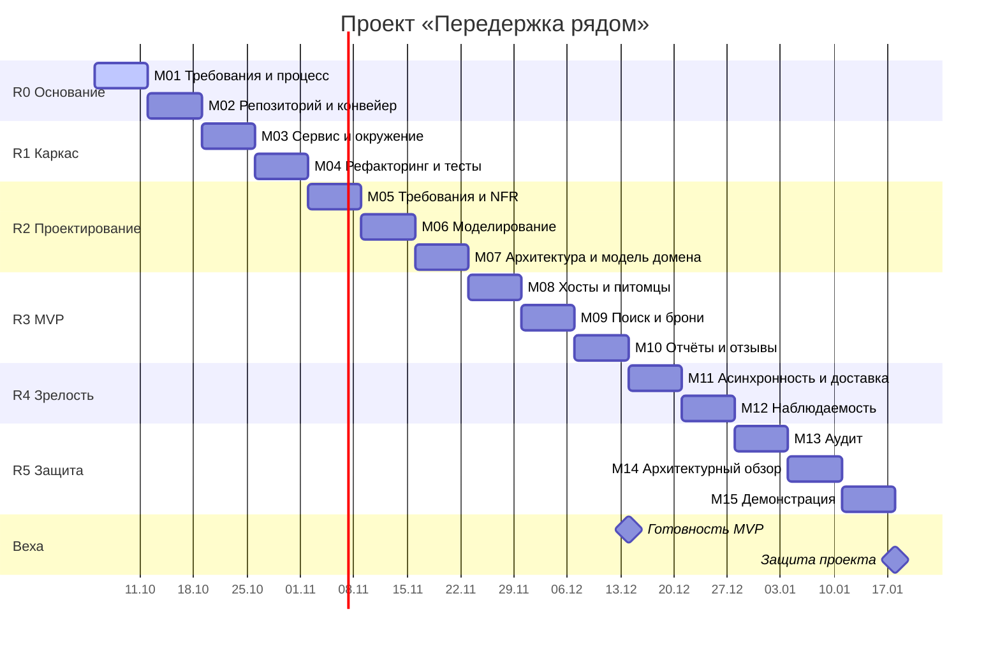

# План семестра (диаграмма Ганта)

Версия 0.1 (05.10.2026).

## Контрольные точки

| Точка | Срок | Критерий прохождения |
|---|---|---|
| Требования утверждены | конец М01 | Домен утверждён преподавателем, MVP и границы зафиксированы |
| Конвейер зелёный | конец М02 | Ветка защищена, проверки документации проходят |
| Сервис поднимается | конец М03 | Одна команда — работающее окружение |
| Модель домена согласована | конец М08 | Описаны хост, питомец, бронь, отчёт, отзыв и их связи |
| MVP работает | конец М11 | Сценарий S1–S10 проходится целиком |
| Защита | конец М15 | Демонстрация и ответы на вопросы |

## Буфер

20 % времени каждой вехи заложено на непредвиденное: при недельной вехе это один день из пяти рабочих. Расход буфера фиксируется в `CHANGELOG.md` отдельной записью. Если буфер израсходован дважды подряд, обсуждаем срез объёма на ближайшей синхронизации.

## Вертикальные срезы внутри реализации

| Неделя | Срез | Результат для пользователя |
|---|---|---|
| М09 | Хост создаёт профиль, модератор одобряет; владелец заводит питомца | Можно зарегистрировать хоста и питомца |
| М10 | Поиск, запрос и подтверждение брони, отмена | Можно найти хоста и договориться о датах |
| М11 | Фотоотчёты и отзывы | Сквозной сценарий замкнут |

## Что урежем первым при отставании на две недели

1. Фильтры, уведомления и прочие истории Should/Could.
2. Ответ хоста на отзыв и расширенные статусы заявки.
3. Отмена брони в части нестандартных случаев. Позвоночник S1–S10 сохраняем.
