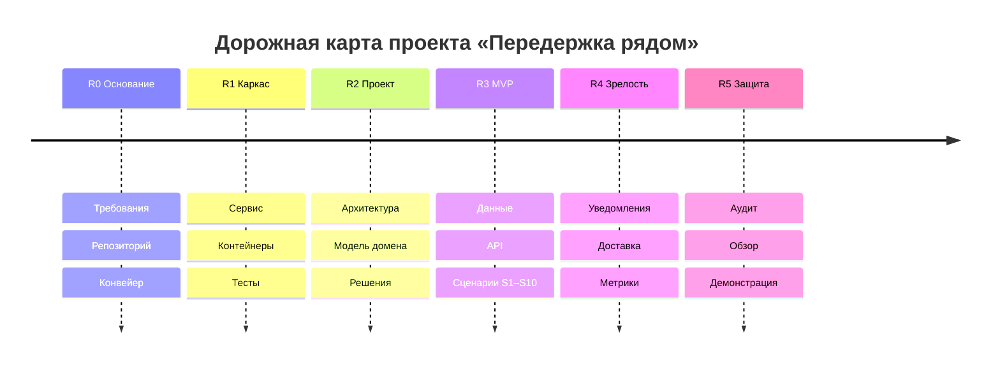

# Дорожная карта

Версия 0.1 (05.10.2026).

| Веха | Модули | Что будет готово для нашего проекта |
|---|---|---|
| **R0. Основание** | М01–М02 | Требования, карты, план и процесс; репозиторий, защита ветки, конвейер проверок документации |
| **R1. Каркас** | М03–М04 | Работающий сервис-заготовка, окружение в контейнерах, первые тесты |
| **R2. Проект** | М05–М07 | Требования с нефункциональными, диаграммы, архитектурные решения, модель предметной области (хосты, питомцы, брони, отчёты) |
| **R3. MVP** | М08–М10 | Данные и миграции, API, клиентские сценарии S1–S10, стратегия тестирования. Сквозной сценарий «нашёл хоста — забронировал — получил отчёт — оставил отзыв» проходится целиком |
| **R4. Зрелость** | М11–М12 | Асинхронные уведомления о брони и отчётах, доставка, наблюдаемость |
| **R5. Защита** | М13–М15 | Клиентское приложение, аудит, архитектурный обзор, демонстрация |

## Принцип нарезки работы

План строится **вертикальными срезами**: каждая неделя после R1 завершает один пользовательский сценарий целиком (данные, сервер, интерфейс), а не слой. Порядок срезов повторяет позвоночник MVP:

1. Хост: профиль и модерация (S1, S2)
2. Владелец: питомец и поиск (S3, S4)
3. Бронирование (S5, S6, S9)
4. Отчёты и отзывы (S7, S8, S10)

## Способ планирования

Основной способ — **от цели** (срок защиты зафиксирован). Внутри каждой вехи оценки пересматриваются **от скорости** по итогам первых двух недель: если реальный темп ниже плана, режем объём (порядок отказа: Could → Should → отдельные сценарии Must по согласованию с преподавателем).
